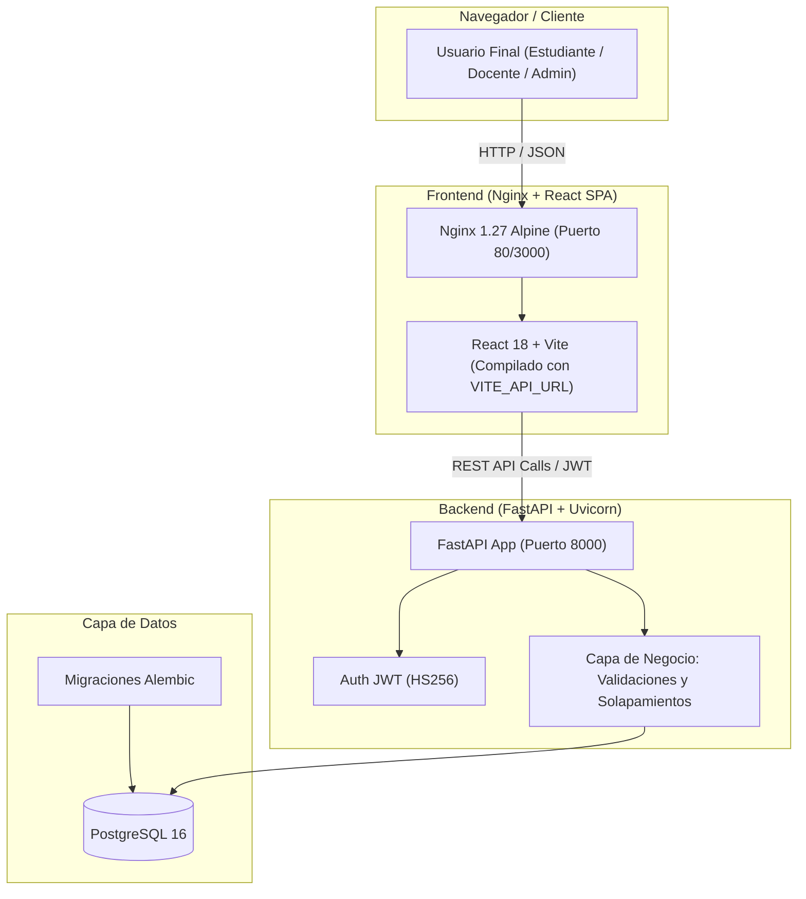

# UniReserve — Sistema Universitario de Gestión de Espacios

[](https://github.com/Juan-Manuel3132007/unireserve-backend/actions/workflows/backend-ci.yml)
[](https://github.com/Juan-Manuel3132007/unireserve-frontend/actions/workflows/frontend-ci.yml)

Plataforma integral para la consulta, reserva y gestión de espacios físicos en campus universitarios (laboratorios, aulas multimedia, salas de estudio y auditorios) con prevención estricta de choques de horario, trazabilidad total de auditoría y arquitectura orientada a la nube.

Trabajo de la asignatura **Gestión de la Configuración** — Universidad de Medellín.

---

## 🏛️ Arquitectura del Sistema

El sistema implementa una arquitectura desacoplada de 3 capas (Frontend SPA ↔ API REST ↔ Base de Datos Relacional) y sigue los principios de los **12 Factores**:



---

## 🗺️ Mapa de Repositorios y Submódulos

UniReserve orquesta su ecosistema mediante submódulos Git independientes, permitiendo versionamiento y ciclos de integración continua autónomos:

```
unireserve/                                         # Repositorio Orquestador
├── .gitmodules                                     # Configuración de submódulos
├── docker-compose.yml                              # Orquestación multicontenedor local
├── docs/                                           # Historias de usuario y sustentación
│   └── sustentacion/                               # Documentación y scripts de sustentación
├── k8s/                                            # Manifiestos de Kubernetes (Namespace: unireserve)
├── backend/ @ daa9be8                             # Submódulo -> unireserve-backend
└── frontend/ @ ec43bd5                            # Submódulo -> unireserve-frontend
```

| Componente | Repositorio | Imagen DockerHub | Pipeline CI |
|---|---|---|---|
| **Orquestador** | [unireserve](https://github.com/Juan-Manuel3132007/unireserve) | — | — |
| **Backend API** | [unireserve-backend](https://github.com/Juan-Manuel3132007/unireserve-backend) | [`juanma313/unireserve-backend`](https://hub.docker.com/r/juanma313/unireserve-backend) | Ruff, Pytest (56 tests en Postgres real), Docker Build & Push |
| **Frontend SPA** | [unireserve-frontend](https://github.com/Juan-Manuel3132007/unireserve-frontend) | [`juanma313/unireserve-frontend`](https://hub.docker.com/r/juanma313/unireserve-frontend) | ESLint, Vitest, Vite Build, Docker Build & Push |
| **Base de Datos** | PostgreSQL Oficial | `postgres:16-alpine` | Gestión de esquema vía Alembic |

---

## 🚀 Instalación y Despliegue desde Cero

### 1. Clonar el repositorio con submódulos
Para descargar el orquestador junto con el frontend y el backend en un solo comando:
```bash
git clone --recurse-submodules https://github.com/Juan-Manuel3132007/unireserve.git unireserve
cd unireserve
```

> **Tip**: Si clonaste sin `--recurse-submodules`, inicializa los submódulos ejecutando:
> ```bash
> git submodule update --init --recursive
> ```

### 2. Configurar variables de entorno
```bash
# En Windows (PowerShell):
Copy-Item .env.example .env

# En Linux / macOS:
cp .env.example .env
```

### 3. Levantar con Docker Compose
```bash
docker compose up --build
```
Una vez iniciado el stack:
- **Frontend SPA**: [http://localhost:3000](http://localhost:3000)
- **API REST & Swagger UI**: [http://localhost:8000/docs](http://localhost:8000/docs)
- **Healthcheck Liveness**: [http://localhost:8000/health](http://localhost:8000/health)
- **Healthcheck Readiness (DB)**: [http://localhost:8000/health/ready](http://localhost:8000/health/ready)

### 4. Despliegue en Kubernetes
Los manifiestos y la guía técnica para despliegue en clúster local (Minikube) o nube se encuentran en la carpeta [k8s/](k8s/README.md).

---

## 👥 Credenciales de Prueba por Defecto (`RUN_SEED=true`)

| Rol | Correo Institucional | Contraseña |
|---|---|---|
| **Administrador** | `admin@unireserve.com` | `Admin123!` |
| **Estudiante** | `juan.restrepo@unireserve.com` | `Estudiante123!` |
| **Profesor** | `profesor@unireserve.com` | `Profesor123!` |

---

## 🧪 Pruebas Automatizadas

- **Backend**: 56 pruebas con `pytest` ejercitando autenticación, control de solapamiento de reservas en intervalo `[inicio, fin)` y autorización de roles contra PostgreSQL real.
- **Frontend Unit/Componentes**: Pruebas con `vitest` en componentes y páginas de registro/disponibilidad.
- **E2E**: Pruebas de integración de extremo a extremo con `playwright`.
